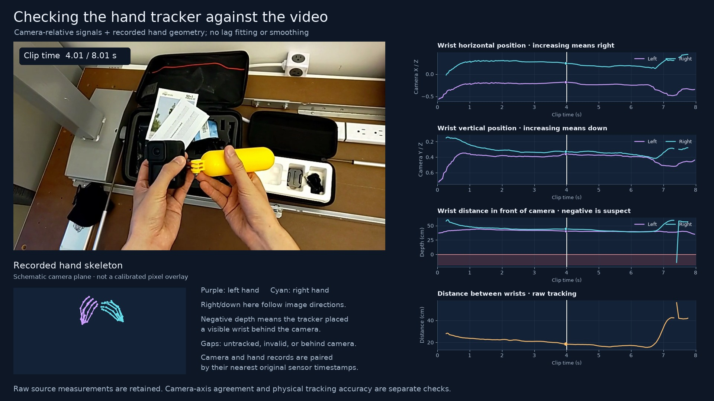

# HoloAssist hand-movement sample

An **8.013-second HoloAssist excerpt** with both hands' joint measurements, the corresponding video, an Excel workbook, and reproducible visualizations. It is a small teaching/inspection sample from the original dataset, not a new capture or the full HoloAssist release.



## Open the included files

- [Original hand-movement clip](sample/hand_movement.mp4)
- [Video with wrist-position and finger-opening plots](sample/hand_signals_with_video.mp4)
- [Camera-relative tracking diagnostic with a schematic skeleton](sample/hand_tracking_diagnostic.mp4)
- [Excel workbook](sample/hand_tracking.xlsx)
- [Numeric data in JSON](sample/hand_data.json)
- [Plain column-by-column dictionary](docs/column_dictionary.csv)
- [Data dictionary and coordinate definitions](docs/data_dictionary.md)

## Sample details

| Item | Value |
|---|---|
| Original recording | `R0027-12-GoPro` |
| Interval in original MP4 | `[369.004068, 377.017008)` seconds |
| Duration | 8.01294 seconds |
| Original frame interval | `[9026, 9222)`, zero-based, exclusive end |
| Video frames | 196 |
| Hand samples | 240 per hand |
| Joints | 26 per hand; 52 total |
| Excel columns | 554 in each hand sheet: 8 metadata + 546 joint-related columns |

The 546 joint-related columns contain matrix entries, duplicated XYZ positions and quality flags. They are not 546 independent physical sensors. Combining both hands gives 1,092 numeric columns after excluding each hand's eight metadata columns.

## Install

Use Python **3.11 or newer**. From this repository's root folder:

```sh
python3 -m venv .venv
source .venv/bin/activate
python -m pip install --upgrade pip
python -m pip install -r requirements.txt
```

On Windows, use `python -m venv .venv` and `.venv\Scripts\activate` instead. FFmpeg comes with `imageio-ffmpeg`; an existing FFmpeg executable on PATH is also supported. There are no Node.js, Codex, Gurobi, or proprietary artifact-library dependencies.

## Recreate the Excel and videos from the included sample

After installing dependencies, this requires **no dataset download**:

```sh
python reproduce.py
```

It rebuilds the workbook, checks its values against the original raw excerpt, recreates both visualization videos and updates the sample checksums. The original excerpted MP4 remains the video input. Re-encoded video bytes can differ across FFmpeg versions; the script checks frame count and presentation timestamps rather than claiming binary-identical encodings across platforms.

Individual commands:

```sh
python export_excel.py
python verify_export.py
python make_signal_video.py
python diagnose_hand_signals.py
python plot_columns.py --hand Left
python plot_columns.py --hand Right
```

`plot_columns.py` plots literal exported column values. It applies no camera transform or baseline subtraction, so you can compare it directly to the Excel columns. Choose columns explicitly:

```sh
python plot_columns.py --hand Right --columns Wrist_x_m Wrist_y_m Wrist_z_m
```

## Download from the original release and rebuild the excerpt

This optional route downloads about **276 MB** for the selected session, using HTTP byte ranges to avoid downloading entire release TAR files:

```sh
python reproduce.py --from-source
```

The original session is stored in ignored `download_cache/`. The selected clip start is pinned to 369 seconds and snapped to the actual video-frame boundary, producing the interval listed above. The script saves the matching original hand lines and nearby camera poses into `sample/raw/`.

The stages are also available independently:

```sh
python download_sample.py
python extract_hand_clip.py --start 369 --duration 8
python make_raw_excerpt.py
```

## What the visualizations mean

`make_signal_video.py` shows world-coordinate wrist changes in centimetres relative to each hand's first usable sample, and the 3D thumb-tip/index-tip distance.

`diagnose_hand_signals.py` uses camera poses matched by original sensor timestamps. It plots camera-normalized horizontal/vertical wrist position (`X/Z`, `Y/Z`), wrist depth and 3D distance between wrists. Its skeleton is a **schematic camera-plane view**, not a calibrated overlay on the video pixels. Camera intrinsics are not included and no fitted calibration or visually chosen lag is applied.

## Known tracking limitations

- Two repeated right-wrist records near clip time **7.411 seconds** transform behind the camera despite their tracked/valid flags. These records are retained and highlighted, not corrected or smoothed away.
- Some nearest camera-pose matches differ from hand timestamps by up to about **95.5 ms**. Shared source-grid rows can differ in their actual sensor times by up to about **104.5 ms**.
- World X/Y/Z do not correspond directly to horizontal/vertical image movement.
- Missing values are not replaced with zero. A valid/tracked flag alone does not establish physical measurement accuracy.

Export checks establish that the saved numbers match the source excerpt. Re-encoding timestamp checks establish that the visualization follows the clip's frame timing. Neither is a certificate of accurate physical hand tracking or perfect sensor-to-image alignment.

## Files and provenance

```text
sample/
  hand_tracking.xlsx           # Left_hand, Right_hand, Matrix_rows, Read_me
  hand_data.json               # same numeric measurements used by the scripts
  hand_movement.mp4            # selected original video frames, re-encoded, no audio
  hand_signals_with_video.mp4
  hand_tracking_diagnostic.mp4
  raw/
    Hands/Left_sync.txt        # exact original 240 selected lines
    Hands/Right_sync.txt       # exact original 240 selected lines
    Video/Pose_sync.txt        # original camera rows, with nearby time margins
    Video/VideoMp4Timing.txt   # original full-session video start/end ticks
  raw_excerpt_manifest.json   # hashes and provenance for the small original excerpts
  download_manifest.json      # upstream archive names, sizes and byte offsets
  validation.json             # original clip selection and full upstream source hashes
  excel_validation.json       # source/Excel value checks
  tracking_diagnostic.json    # camera-relative diagnostic checks
  sample_manifest.json        # checksums of the distributed sample files
```

The upstream source hashes in `validation.json` identify the original full-session files; they are distinct from the smaller excerpt hashes in `raw_excerpt_manifest.json`. Only the small excerpt is committed. Full recordings, environments, cache directories and debugging dumps are excluded by `.gitignore`.

## Verify

```sh
python -m unittest discover -s tests
python verify_export.py
python make_manifest.py --check
```

The workbook validator checks 915,988 exported cell values, including 49,920 matrix-layout rows, and maps 262,080 joint values back to the original hand text excerpts. Exact 18-digit sensor timestamps remain text in Excel. See the saved validation JSON files for results.

## License and citation

The redistributed HoloAssist data, excerpted video and reformatted measurements are accompanied by the **CDLA-Permissive-2.0** license in [LICENSE-DATA.txt](LICENSE-DATA.txt). Their original source is the [HoloAssist project](https://holoassist.github.io/). The dataset is not relicensed as MIT. See [NOTICE.md](NOTICE.md) for license scope and attribution.

Please cite the original HoloAssist paper using [CITATION.bib](CITATION.bib).

Technical references:

- [HoloAssist dataset structure and synchronization](https://github.com/holoAssist/holoassist.github.io/blob/main/data_links/README.md)
- [PSI joint order, pose matrices and timestamps](https://github.com/microsoft/psi/tree/master/Sources/MixedReality/HoloLensCapture/HoloLensCaptureExporter)
- [Official PyHoloAssist camera-transform code](https://github.com/taeinkwon/PyHoloAssist/blob/main/hand_eye_project.py)
